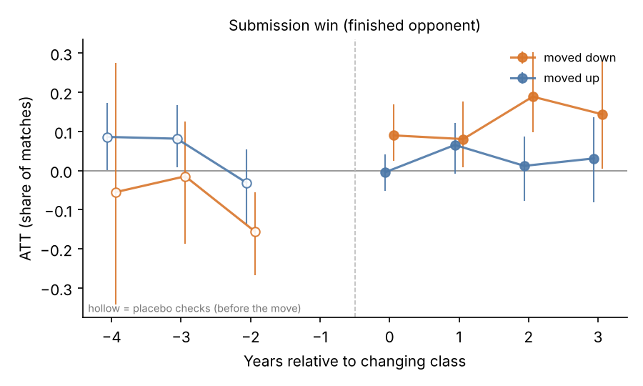

# Does changing weight class change how BJJ matches end?

A staggered difference-in-differences study of Brazilian jiu-jitsu competitors who changed weight class. It asks whether moving up or down a division changes how often a competitor **finishes opponents** by submission, or **gets finished** themselves, overall and for specific submissions.

**Full write-up with charts:** [`docs/index.html`](docs/index.html) (viewable as a web page once GitHub Pages is enabled; see [Viewing the report](#viewing-the-report)).

## Key findings

- **Changing class in either direction goes with more submissions.** Competitors who moved up and competitors who moved down both finished opponents more often afterwards, compared with competitors who hadn't moved. That shared rise is +6.8 percentage points (95% CI +2.7 to +11.3). Because it appears in both directions, it points to something that comes with changing class (career stage, preparation, a new division, different events) rather than to body weight itself.
- **Movers down submit their opponent more than movers up.** Movers down finish 11.0 points more often after the move, movers up 2.7. Half the gap, the *direction effect*, is −4.2 points (−8.5 to −0.7), consistent with being the relatively bigger competitor making finishes easier. Most of it is chokes. This is the least stable result: it's clearly distinguishable from zero at only 3 of 5 data-cleaning thresholds, and movers down were already finishing more in the year before they moved.
- **Getting submitted shows no clear direction effect** (+1.9 points, −1.0 to +6.1). The exception is leg locks: competitors get caught in leg locks more after changing class in either direction (+1.3 points on a base of about 2%), which suggests a shift toward leg-lock-friendly events (no-gi or submission-only).
- **No detectable effect of weight class on overall submission frequency.** Due to the instability of the results, effects larger than about 7 points can be ruled out. So there is no effect larger than that, but a higher confidence analysis would be to be performed to assess if there is a smaller effect. The increased frequency in submissions of those moving down a weight class compared to up does point towards a possibility of some such effect existing, but further analysis is required. 



*Finishing opponents, by years since changing class. Hollow points are placebo checks before the move; filled points are after it. Bars are 95% intervals.*

The data are sparse (86 competitors moved up, 51 moved down, 233 never moved), so these are best read as directions and plausible sizes rather than precise estimates.

## Data

Match records come from [rdreese89/Web-Scraper](https://github.com/rdreese89/Web-Scraper), which scraped them from BJJ Heroes competitor profiles: about 40,000 competitor-match rows for 593 notable competitors, with opponent, result, method, competition, weight class and year.

**The data is not included in this repository.** That repository has no license, so it isn't redistributed here. To reproduce the analysis, download `data.csv` from it and place it in this folder. Files built from it at the level of individual competitors are excluded too; summary results are included in `results/`.

## Method

**Treatment.** A competitor's *typical weight* in a year is the median weight label of their matches. A move is a shift of at least 5 kg (one class step) that persists; wobble of up to 4 kg counts as the same class. Each competitor is labelled as never moved, moved up, or moved down, and dated by the year of the move. For competitors who moved more than once, only their first clean move is used.

**Outcomes.** Each match is seen from one competitor's side. Outcomes are the share of a competitor's decided weight-class matches in a year that are submission wins and submission losses, overall, by family (chokes, arm locks, leg locks) and for eight specific submissions.

**Estimator.** [Callaway & Sant'Anna (2021)](https://doi.org/10.1016/j.jeconom.2020.12.001) staggered difference-in-differences:
- For each move-year cohort and calendar year, movers' change in an outcome is compared with the change among competitors who haven't moved (never-movers, plus later movers before their own move).
- Changes are weighted by how many matches they rest on (match-count weighting).
- Cohort-by-year results are averaged into an overall effect and an event study.
- Uncertainty comes from a bootstrap that resamples whole competitors.

**Separating weight from changing class.** Movers up and movers down are estimated separately, using the same bootstrap draws. If moving up has effect *b + c* and moving down *−b + c*, then:
- **direction effect** *b* = (up − down) / 2 is the part that depends on which way the competitor moved, the candidate for an effect of body weight;
- **common shift** *c* = (up + down) / 2 is the part that comes with changing class at all.

**Placebo checks.** Before-move years are tested for differences between movers and non-movers. Movers often fight some matches at their new weight before their typical weight changes, so placebo checks count only matches within 2 kg of each competitor's typical weight.

## What went wrong in the first version

This is a rebuild of an earlier attempt. The main problems found and fixed:

1. **Federation labels looked like weight changes.** AJP's −85 kg, IBJJF's −82.3/−88.3 kg and ADCC's −88 kg differ, so entering a different federation's event looked like moving class. Fixed by using each competitor's yearly median weight and requiring a persistent shift of at least 5 kg.
2. **"Changed class exactly once" failed on noise.** A single match in another division disqualified competitors. Fixed by dropping years with fewer than 3 matches and excluding open-class matches.
3. **Two-way fixed effects mixed up the comparisons.** The standard competitor-and-year fixed-effects regression uses already-moved competitors as controls for later movers, which biases estimates when effects vary by cohort or over time ([Goodman-Bacon 2021](https://doi.org/10.1016/j.jeconom.2021.03.014)). Replaced with Callaway & Sant'Anna; the naive regression is still reported for contrast.
4. **Gaps in careers.** Each comparison now uses only competitors observed in both of its years.
5. **After-move matches leaked into the placebo checks.** Fixed with the 2 kg match filter. Placebo failures dropped from 16 of 70 points to about the rate expected by chance for getting finished, and about twice that for finishing opponents.

## Validation

- **Against the R [`did`](https://bcallaway11.github.io/did/) package** (Callaway & Sant'Anna's own implementation): on a balanced panel, all 90 estimates are identical. On the full, unbalanced panel the results differ, entirely because `did` treats missing years as repeated cross-sections, comparing whoever competed each year, while this code follows the same competitors. See `r_validation/`.
- **Tests:** 60 tests cover the cleaning rules, weight trajectories, simulated data with a known effect (recovered exactly under every combination of settings), individual comparisons recalculated by hand, and the match with R. A deliberately planted bug in the control-group rule makes 11 of them fail.
- **Sensitivity:** results are rerun at five data-cleaning thresholds, four sample definitions and four placebo methods.

The project-specific choices (match-count weighting, the placebo filter, not-yet-moved controls) can't be run in `did`. They are covered by the hand checks and simulation tests rather than an outside implementation.

## Limitations

- **Small samples and sparse data.** Submission losses are rare (under 8% of matches; under 2% for any single submission), so loss estimates for specific submissions are imprecise. Additionally, the overall data is sparse. The method used severely limits the amount of data that actually contributes, particularly for the more specific questions I am asking, such as rates for specific submissions. 
- **Changing class isn't random.** Comparing changes removes fixed differences between competitors, but not trends that line up with the move. Movers down were already on an upswing just before moving. The main issue here is that changing classes is a premeditated choice made by competitors for a variety of reasons. 
- **The up/down split assumes the same career effect for both groups.** Both a change up and a change down were assessed to minimize the effect of simply progressing in ones career showing up as a weight change effect, but using this as a control does assume that those moving up and moving down share similar career trends, which may not be true. 
- **Gi and no-gi are mixed.** The data don't record them separately.
- **No Rule-set control.** Rule-sets allowing and disallowing certain submissions are not recorded or accounted for in this analysis. These rule-sets vary between federation as well as experience level, so certain changes in the data may be noise from these restrictions. Particularly, certain leg-locks such as heel hooks are restricted depending on experience level and go vs nogi as well as between federations. 
- **Notable competitors only.** BJJ Heroes profiles notable competitors and records their own matches. This analysis may be much different on average competitors/hobbyist as opposed to those competing at a focused and professional level. 

## Repository layout

```
bjj_staggered_did.py     run the full analysis
bjj_did/
  config.py              every analysis choice as a named setting
  cleaning.py            weight labels -> kg; results -> submission family and technique
  sample.py              outcomes, weight trajectories, competitor-year panel
  estimation.py          Callaway & Sant'Anna estimator; naive two-way fixed effects
  plots.py               event-study charts
  pipeline.py            runs everything, writes results/
robustness.py            rerun at different data-cleaning thresholds
compare_specs.py         strict vs expanded samples
placebo_compare.py       placebo methods side by side
tests/                   60 tests (pytest)
r_validation/            comparison with the R did package
results/                 every estimate, plus one chart per outcome
docs/index.html          full write-up
```

## Reproducing

Requires Python 3.10+ with numpy, pandas and matplotlib (`pip install -r requirements.txt`).

```bash
# 1. put data.csv (from rdreese89/Web-Scraper) in this folder
python3 bjj_staggered_did.py data.csv results     # main analysis
python3 robustness.py data.csv results            # sensitivity checks (also compare_specs.py, placebo_compare.py)
python3 -m pytest                                 # tests; data-dependent ones skip if data.csv is missing
```

To rerun the R comparison: `python3 r_validation/make_validation_data.py data.csv`, then `Rscript r_validation/validate_did.R` (installs the `did` package on first run).

## Viewing the report

To view `docs/index.html` as a web page, go to the repository's **Settings → Pages**, set the source to **Deploy from a branch**, choose **main** and **/docs**, and save. GitHub then shows the page's address.

## License

Code is released under the MIT License (see `LICENSE`). The match data is not covered by this license and is not distributed here.
